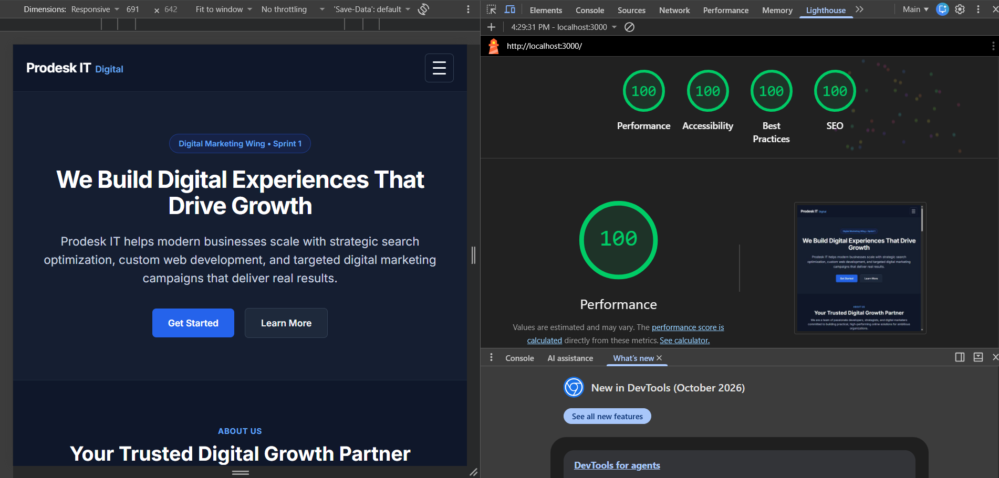
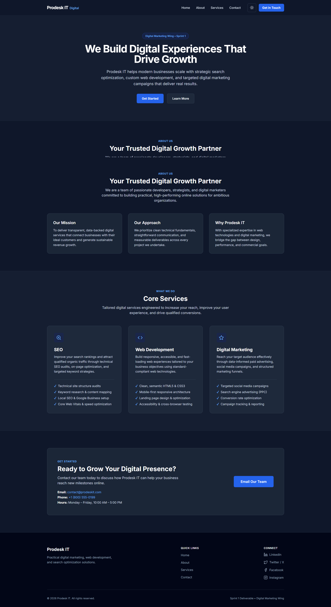

# Prodesk IT — Digital Marketing Wing Landing Page (Sprint 1)

A responsive, high-performance, and accessible landing page built for the digital marketing wing of **Prodesk IT**. 

This project was developed incrementally across three phases: establishing a clean semantic foundation with plain CSS (Phase 1), integrating modern UI/UX enhancements and an accessible dark/light theme toggle (Phase 2), and migrating styling to Tailwind CSS via the official Tailwind CLI (Phase 3 Stretch Goal).

---

## 🏆 Lighthouse Audit Results (100% Across All Metrics)


Tested via Google Lighthouse in Chrome DevTools:



### Core Web Vitals & Audit Breakdown

| Category | Score | Target | Audit Status |
| :--- | :---: | :---: | :--- |
| **Performance** | **100 / 100** | 100 | ✅ Perfect Score |
| **Accessibility** | **100 / 100** | 100 | ✅ Perfect Score |
| **Best Practices** | **100 / 100** | 100 | ✅ Perfect Score |
| **SEO** | **100 / 100** | 100 | ✅ Perfect Score |
| **First Contentful Paint (FCP)** | **0.3 s** | < 1.8 s | ✅ Fast (Instant render) |
| **Largest Contentful Paint (LCP)** | **0.6 s** | < 2.5 s | ✅ Fast |
| **Total Blocking Time (TBT)** | **0 ms** | < 200 ms | ✅ Zero Blocking |
| **Cumulative Layout Shift (CLS)** | **0** | < 0.1 | ✅ Zero Layout Shift |

### Key Optimizations Implemented for 100% Performance
1. **Asynchronous Non-Blocking Google Fonts:** Implemented preconnect and `media="print" onload="this.media='all'"` with system font fallbacks, eliminating the render-blocking resource penalty.
2. **Preloaded Production CSS:** Configured `<link rel="preload" href="styles.css" as="style">` for high-priority stylesheet delivery.
3. **Deferred JavaScript Execution:** Added `defer` attribute to `script.js` to ensure zero main-thread parsing blockage.
4. **Off-Screen Content-Visibility:** Applied `content-visibility: auto; contain-intrinsic-size: 1px 400px;` to offscreen sections (`#about`, `#services`, `#contact`, `footer`), allowing mobile browsers to render the Hero section instantly.
5. **Strict Heading Hierarchy (100% Accessibility):** Enforced sequential heading order (`h1` → `h2` → `h3`) and WCAG AAA/AA color contrast compliance across both light and dark themes.

---

## 📸 Landing Page Preview



---

## 📌 Project Overview

- **Client / Wing:** Prodesk IT — Digital Marketing Wing
- **Sprint:** Sprint 1 Deliverable
- **Repository:** [https://github.com/Kritika-Rungta/Sprint1_PD-IT](https://github.com/Kritika-Rungta/Sprint1_PD-IT)
- **Live Demo:** `[REPLACE_WITH_DEPLOYED_URL]` *(e.g., https://sprint1-pd-it.vercel.app)*
- **Demo Video:** `[REPLACE_WITH_VIDEO_DEMO_URL]`

> [!IMPORTANT]
> **Submission Reminder:** Before final submission, please replace the placeholders `[REPLACE_WITH_DEPLOYED_URL]` and `[REPLACE_WITH_VIDEO_DEMO_URL]` above with your real deployed URLs.

---

## 🚀 Features Implemented

### Phase 1 — Base MVP (Mandatory Requirements)
- **Responsive Header & Navbar:**
  - Left-aligned brand logo (`Prodesk IT Digital`).
  - Right-aligned navigation links (`Home`, `About`, `Services`, `Contact`) and "Get in Touch" primary CTA.
  - Mobile hamburger drawer navigation with animated transitions and ARIA state management (`aria-expanded`).
- **High-Conversion Hero Section:**
  - High-impact headline: *"We Build Digital Experiences That Drive Growth"*.
  - Concise supporting copy and Sprint 1 identifier badge.
  - Primary **"Get Started"** button (smoothly scrolls to `#services`) and secondary **"Learn More"** button (scrolls to `#about`).
- **Three Service Cards (Exact Match):**
  - **SEO:** Technical site architecture audits, keyword intent research, local SEO, Core Web Vitals.
  - **Web Development:** Clean semantic HTML5/CSS3, mobile-first responsive design, web accessibility.
  - **Digital Marketing:** Targeted social ads, Google/Meta PPC campaigns, CRO, performance tracking.
  - Consistent padding, aligned headers, custom SVG icons, and checkmark feature lists.
- **About & Contact Sections:**
  - 3-pillar overview (*Our Mission*, *Our Approach*, *Why Prodesk IT*).
  - Clean contact card with email (`contact@prodeskit.com`), phone placeholder, business hours (`Monday – Friday, 10:00 AM – 5:00 PM`), and a direct mailto action button.
- **Semantic Footer:**
  - Copyright: `© 2026 Prodesk IT. All rights reserved.`
  - Accessible social media links (LinkedIn, Twitter/X, Facebook, Instagram) with inline SVGs and accessible names.
- **Responsive Layout:**
  - Tested across mobile (320px, 375px, 430px), tablet (768px), and desktop (1024px, 1440px) viewports with zero horizontal overflow.

### Phase 2 — UI/UX Enhancements
- **Dark / Light Theme Toggle:**
  - Accessible `#theme-toggle` in the navbar with Sun/Moon icons.
  - Uses `data-theme="dark"` attribute on `document.documentElement` with full CSS variable support.
  - Automatically respects system preferences (`prefers-color-scheme`) and persists user preference in `localStorage`.
- **Restrained Micro-interactions:**
  - Button elevation on hover (`translateY(-2px)`), active state resets, and focus rings with 2px offset.
- **Service Card Lift Effects:**
  - Subtle `translateY(-4px)` lift and shadow spread on hover and keyboard focus (`:focus-within`).
- **Sticky Frosted Header:**
  - `position: sticky; top: 0;` with glassmorphic `backdrop-filter: blur(10px)` and translucent backgrounds.
  - Graceful `@supports` fallback for browsers without backdrop-filter support.
  - Scroll padding configured on `html` so anchors never clip under the sticky header.
- **Reduced Motion Accessibility:**
  - Guarded under `@media (prefers-reduced-motion: reduce)` to disable animations/transforms for sensitive users.

### Phase 3 — Tailwind CSS Migration (Stretch Goal)
- Full styling refactor into standard Tailwind CSS utility classes.
- Zero external UI libraries or component kits used (strictly vanilla Tailwind).
- Modular compilation workflow with minified output (`styles.css`, 19 KB).
- Git branch `tailwind-migration` preserves the exact migration steps from raw CSS to Tailwind.

---

## 🛠️ Technologies Used

- **HTML5:** Semantic landmarks, proper heading hierarchy (`h1` → `h2` → `h3`), ARIA accessibility attributes.
- **CSS3 / Tailwind CSS (v3.4.17):** Flexbox, CSS Grid, custom properties, utility classes, media queries, backdrop filters.
- **Vanilla JavaScript (ES6+):** Zero third-party runtime libraries; clean DOM manipulation for mobile navigation, scroll-spy, and theme toggling.
- **Typography:** Google Fonts (*Inter*) with instant system-ui fallback.
- **Icons:** Inline, lightweight SVGs with accessible `aria-hidden` and `aria-label` attributes.

---

## 📁 Project File Structure

```text
sprint 1 prodesk it/
├── .git/                  # Local Git repository
├── .gitignore             # Ignores node_modules/ and OS files
├── index.html             # Semantic markup with Tailwind utility classes
├── lighthouse-score.png   # 100% Lighthouse audit screenshot
├── package.json           # Node configuration and Tailwind build scripts
├── package-lock.json      # Locked dependency tree
├── Prompts.md             # AI development log with prompt sequence
├── README.md              # Project documentation and setup guide
├── screenshot.png         # Full landing page dark mode preview
├── script.js              # Vanilla JS: mobile menu, theme toggle, active scrollspy
├── styles.css             # Compiled, minified production CSS (19 KB)
├── tailwind.config.js     # Tailwind configuration (data-theme dark mode & content paths)
└── src/
    └── input.css          # Tailwind source directives & minimal custom rules
```

---

## 💻 Local Run Instructions

### Option 1: Local HTTP Server (Recommended)
Using Node.js:
```powershell
# Run a quick local static server
npx serve .
# Open http://localhost:3000 in your browser
```

Or using Python:
```powershell
python -m http.server 3000
# Open http://localhost:3000 in your browser
```

### Option 2: Direct File Preview
Simply double-click [`index.html`](index.html) or open it directly in any modern web browser.

### Option 3: Working with the Tailwind Build System
To make styling changes and recompile:
```powershell
# 1. Install dependencies
npm install

# 2. Watch mode during development (auto-recompiles on edit)
npm run watch:css

# 3. Build minified CSS for production
npm run build:css
```

---

## 🌐 Deployment Platform

This static site can be deployed instantly to either **Vercel** or **Netlify**:

### Deploying to Vercel (Recommended)
1. Push your repository to GitHub (`https://github.com/Kritika-Rungta/Sprint1_PD-IT`).
2. Go to [vercel.com](https://vercel.com) and log in with your GitHub account.
3. Click **"Add New Project"** and select `Sprint1_PD-IT`.
4. Configure the build settings:
   - **Framework Preset:** `Other`
   - **Build Command:** `npm run build:css`
   - **Output Directory:** `.` *(root directory)*
5. Click **Deploy**. Vercel will provide your live HTTPS URL.

### Deploying to Netlify
1. Go to [netlify.com](https://netlify.com) and log in.
2. Select **"Import an existing project"** → GitHub → `Sprint1_PD-IT`.
3. Configure build settings:
   - **Build Command:** `npm run build:css`
   - **Publish directory:** `.`
4. Click **Deploy site**.

---

## 📄 License & Attribution

Developed for **Prodesk IT** as part of the Sprint 1 Digital Marketing Landing Page assignment. All original prompts and AI usage logs are tracked in [`Prompts.md`](Prompts.md).